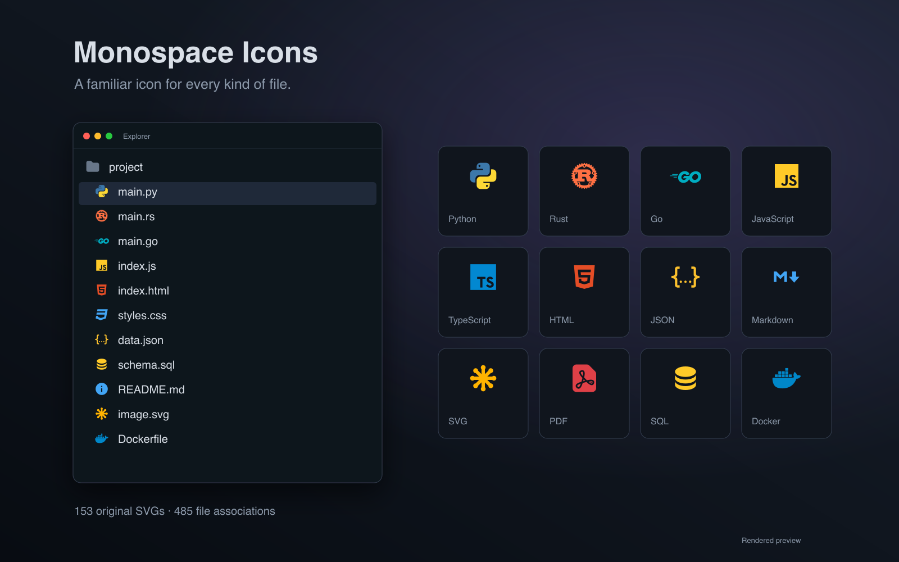
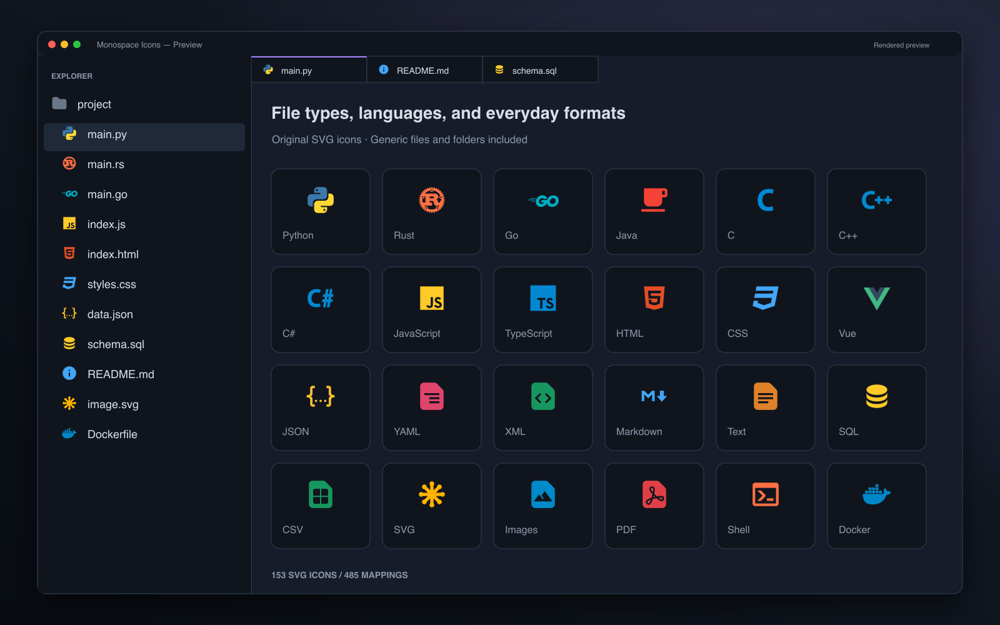

# Monospace Icons for Orca

Familiar files, at a glance.

The original [Monospace](https://github.com/keksiqc/monospace-theme) SVG icons by **Keksi**, curated for [Orca](https://onorca.dev). A consistent set for programming languages, documents, images, data files, and configuration files.

[](https://onorca.dev) [](#file-coverage) [](#file-coverage) [](LICENSE)



## Install

Requires **Orca 1.4.245 or newer**.

1. Open **Settings → Plugins**.
2. Choose **Add plugin → From a Git URL…** and enter:

   ```text
   https://github.com/faisalmuhammad/orca-monospace-icons#v1.0.3
   ```

   Keep `#v1.0.3` at the end. Orca requires a release tag or commit hash to install from Git.
3. In **Settings → Appearance**, select **Monospace Icons** as the file icon theme.

Use it with your preferred color theme, or pair it with [Monospace Light and Dark](https://github.com/faisalmuhammad/orca-monospace-themes).

## Preview



The cover and preview are **rendered illustrations**, not screenshots captured from Orca. Every icon shown comes from the plugin's original SVG assets.

## File coverage

**153 original SVGs · 485 mappings · Generic file and folder fallbacks**

| Category | Examples |
| --- | --- |
| Programming languages | Python, Rust, Go, Java, C, C++, C#, JavaScript, TypeScript |
| Web formats | HTML, CSS, SCSS, React, Vue, Svelte |
| Documents and images | Markdown, plain text, PDF, PNG, JPEG, SVG |
| Data formats | JSON, YAML, XML, CSV, SQL |
| Scripts and tools | Shell scripts, Dockerfile, package files, lockfiles, configuration files |
| Compound filenames | TypeScript declarations, test files, and framework-specific suffixes |

Exact filenames take precedence over extension mappings. Compound suffixes distinguish files such as `types.d.ts` and `app.spec.ts` from ordinary TypeScript files. Unmatched files use the generic file icon; closed and open folders share the original folder SVG.

The SVGs retain their original colors and shapes.

<details>
<summary>Port details and local development</summary>

Orca's icon format maps filenames and extensions directly to SVG paths. The port lowercases keys, keeps the first conflicting upstream entry, and includes only referenced assets. Some upstream language-ID associations are translated to explicit extensions.

This curated port omits named-folder associations, remaining language-ID associations, light-specific variants, mappings beyond the artifact limit, and the text-only DenizenScript icon that Orca cannot render. Unmapped files use the generic file icon.

The mapping artifact is **16,317 bytes**, below Orca's 16 KiB limit. Mapping and SVG counts stay below 512, and every SVG is below 64 KiB.

To work on the plugin locally, clone this repository and add its root through **Settings → Plugins → Development folders…**. From a compatible Orca source checkout, validate it with:

```sh
pnpm validate:plugin path/to/orca-monospace-icons
```

</details>

## Attribution and license

An unofficial Orca port of the icon theme included with [Monospace Theme](https://github.com/keksiqc/monospace-theme) by **Keksi** (`keksiqc`), maintained for Orca by [faisalmuhammad](https://github.com/faisalmuhammad).

The port uses extension version **1.5.0**, pinned to upstream commit [`50761831abba262d3c259925fbddb1f6492ef891`](https://github.com/keksiqc/monospace-theme/tree/50761831abba262d3c259925fbddb1f6492ef891). The copied SVGs preserve the source bytes.

| Source notice | License | Included notice |
| --- | --- | --- |
| Monospace — Copyright © 2024 Keksi | MIT | [LICENSE](LICENSE) |
| Google-derived icon assets distributed upstream | Apache 2.0 | [LICENSE-GOOGLE](LICENSE-GOOGLE) |
| Seti — Copyright © 2014 Jesse Weed | MIT | [LICENSE-SETI](LICENSE-SETI) |

The repository's MIT license does not replace the licenses of third-party assets. Original notices are preserved verbatim; see [third-party notices](THIRD_PARTY_NOTICES.md) for provenance and scope.
